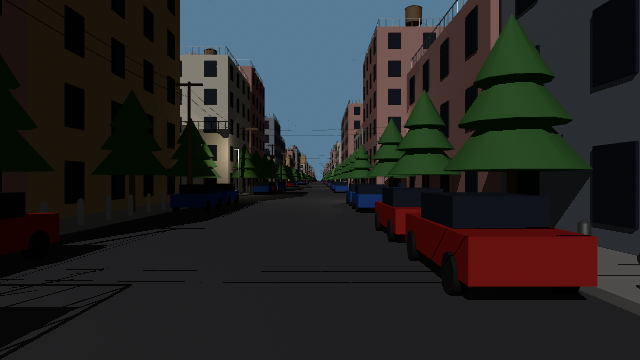
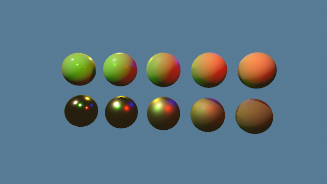
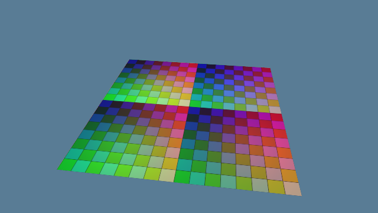
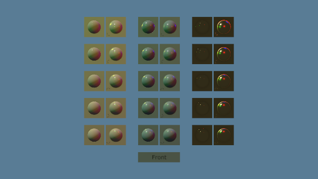
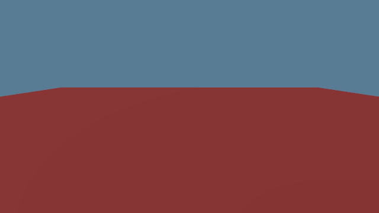
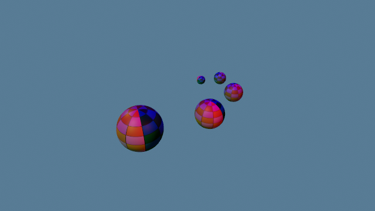
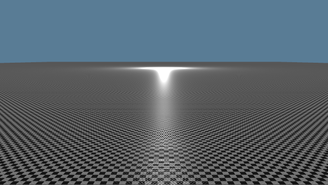
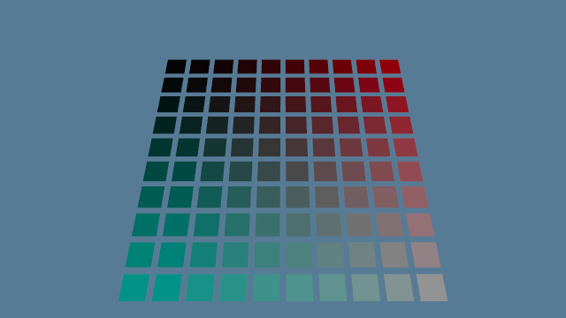
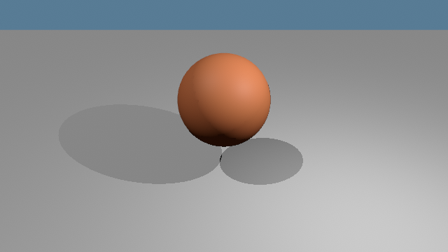

# Praxis

Open-world RPG engine in Rust and wgpu, written from scratch.



`town`: a procedural 1 km town, ~250,000 instances, 1,024 street lamps,
ray-traced shadows.

**Status:** early. It is a renderer for now: no editor, gameplay, physics,
audio or scripting yet.

[Bench history](https://gariasf.github.io/praxis/bench/) ·
[Field guides](https://gariasf.github.io/praxis/guides/) ·
[Roadmap](ROADMAP.md) ·
[Decisions](docs/adr/) ·
[Glossary](CONTEXT.md) ·
[Workflow](docs/agents/workflow.md)

## Features

- Clustered forward shading with 4x MSAA at native resolution. No TAA,
  upscaling or frame generation ([0008](docs/adr/0008-stable-image-without-temporal-tricks.md),
  [0019](docs/adr/0019-clustered-forward-main-pass-with-4x-msaa.md))
- GPU culling against a two-phase Hi-Z pyramid
- glTF 2.0 PBR, lights in lux and candela, EV100 exposure, HDR and
  tonemapping ([0023](docs/adr/0023-lights-are-photometric-as-gltf-defines-them.md))
- Hard ray-traced shadows with inline ray queries
  ([0020](docs/adr/0020-ray-traced-probe-gi-and-hard-ray-traced-shadows.md))
- f64 world positions, rendered camera-relative
  ([0014](docs/adr/0014-world-positions-are-f64-the-gpu-works-camera-relative.md));
  reverse-Z with no far plane
  ([0015](docs/adr/0015-reverse-z-depth-with-an-infinite-far-plane.md))
- Fixed 64 Hz simulation, interpolated for rendering
  ([0022](docs/adr/0022-fixed-64-hz-simulation-with-interpolation.md))
- Cooked assets: stable IDs, content-hashed blobs, BC textures, fixed
  geometry arenas ([0017](docs/adr/0017-textures-stream-by-mip-geometry-lives-in-fixed-arenas.md),
  [0018](docs/adr/0018-cooked-assets-are-named-by-stable-ids-and-stored-by-content-hash.md))
- Golden images, benches and frame stats (CPU, GPU, memory) checked on
  every change

wgpu is the only graphics API
([0007](docs/adr/0007-wgpu-is-the-permanent-graphics-api.md)), and
`bevy_ecs` is used without the rest of Bevy
([0009](docs/adr/0009-bevy-ecs-as-a-standalone-crate.md)). Single-player,
desktop only: Windows, Linux, macOS
([0010](docs/adr/0010-single-player-desktop-only.md)).

## Roadmap

| | | |
| --- | --- | --- |
| M0 | Verify command, goldens, benches, frame stats | done |
| M1 | Frame foundations: f64 positions, reverse-Z, threading, fixed step | done |
| M2 | Cooked assets | done |
| M3 | Main pass: culling, MSAA, lighting, ray-traced shadows, HDR | in progress |
| M4 | Streamed world: LOD and streaming | |
| M5 | Global illumination: ray-traced probes | |
| M6 | World content | |
| M7 | Gameplay core and physics | |
| M8 | Audio and AI | |
| M9 | Editor | |

A milestone closes when its exit criteria, commands with numbers, have
been run. The long view is in [ROADMAP.md](ROADMAP.md).

Budget ([0013](docs/adr/0013-reference-hardware-and-provisional-budgets.md)):
60 fps at 2560×1440 on an M4 Pro, with 6 ms of CPU, 12 ms of GPU and 8 GB
of GPU memory.

## Building

- Rust 1.89 or newer
- A GPU with inline ray queries; `praxis capabilities` checks it against
  the floor ([0021](docs/adr/0021-capability-floor.md))

I develop on an M4 Pro (Metal) and an RTX 2070 SUPER (Vulkan and DX12). CI
renders on lavapipe, Mesa's software Vulkan.

```sh
cargo run --release                          # helmet scene, in a window
cargo run --release -- town                  # any scene below, by name
cargo run --release -- capabilities          # this GPU against the floor
cargo run --release -- capture town town.png 1280x720
scripts/verify.sh                            # fmt, clippy, build, tests, bench counters
```

The first run downloads the helmet model and cooks assets into `cooked/`.

| Input | Action |
| --- | --- |
| Mouse | Look |
| W A S D | Move |
| Space / Left Shift | Up / down |
| G / H | Add / remove a helmet (helmet scene) |
| Esc | Quit |

## Scenes

Test scenes, each one benched. Images are the Metal goldens, 640×360.

| | |
| --- | --- |
|  | **pbr-sweep**: metallic × roughness sphere grid. |
|  | **uv-grid**: grid texture on a plane, tiled twice. |
|  | **normal-tangent**: Khronos NormalTangentTest; real bumps beside normal-mapped quads. |
|  | **far-coplanar**: two planes 1 cm apart, 2 km away at a grazing angle. Reverse-Z keeps them apart. |
|  | **orrery**: spheres orbiting and spinning in their parents' frames, interpolated between ticks. |
|  | **minification**: glossy checker floor, 100 m, under a raking light. Mips, anisotropic filtering, Toksvig. |
|  | **texture-wall**: 10,000 resident textures sampled by 100 quads. |
|  | **shadows**: sphere over a plane, sun and point light; ray-traced shadow against the analytic one. |

Plus `town` (top), and two without goldens:

- **helmet**: the SciFiHelmet sample model and a material sweep. The model
  is downloaded, not committed.
- **crowd**: 100 figures bent on the GPU every frame, a stand-in for
  skinning, with shadows from per-bone proxies.

## License

[MIT](LICENSE). Files under `assets/` keep their own licences, listed in
[assets/ATTRIBUTION.md](assets/ATTRIBUTION.md).
