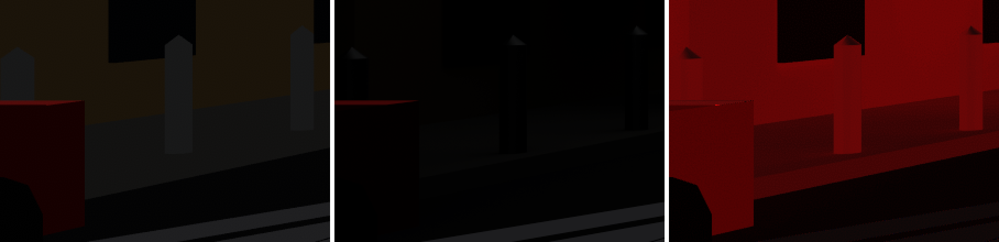
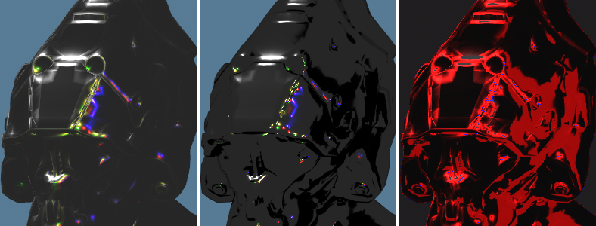
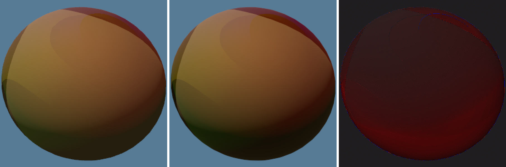
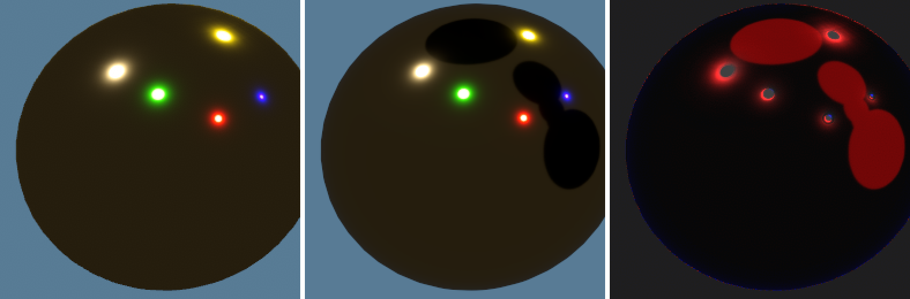
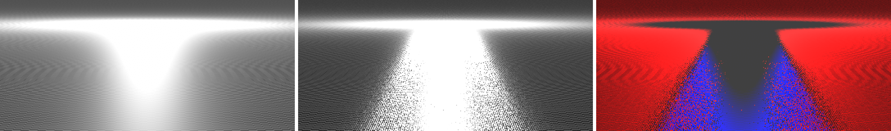
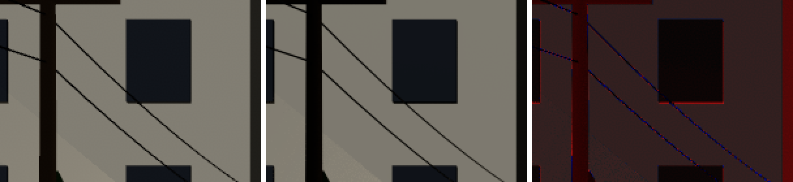
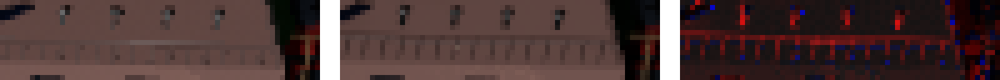
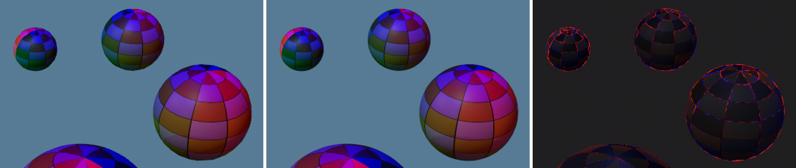
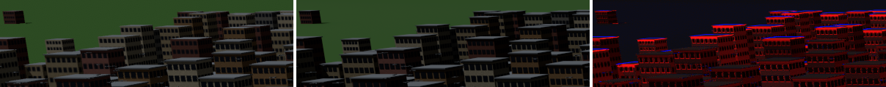
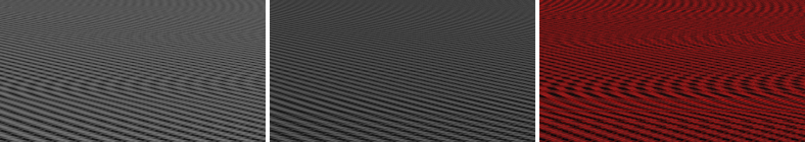

# Known differences from the Cycles reference

What praxis does not do yet, or does on purpose, and how each shows beside
its Cycles render, so that neither an audit nor a review reads it as a
defect. Anything else a Cycles difference image shows is a finding. Each
item carries its tag: `deliberate until <trigger>`, or `ticketed` with its
ticket once the triage opens a fix. This is the image half of the engine's
Deviations; the rest, where the code should not match the literature and
why, is `docs/audit/deviations.md`.

Each crop is praxis | Cycles | difference, cut by `compare.py crop` from a
gallery (`scripts/gallery.sh` with `PRAXIS_BLENDER` set), at 2x unless its
caption names another scale. The
difference is praxis's capture dimmed to a quarter, red where praxis is
brighter and blue where Cycles is, at four times the channel that differs
most. A difference of an 8-bit step or so everywhere is praxis's dither, which the Cycles image does not carry,
and fine speckle in Cycles' brightest highlights is its sampling noise.

The reference is direct light only, as praxis has no indirect light yet: a
reflection of another surface is black in Cycles.

## Ambient light without visibility

Tag: `deliberate until ADR 0020's irradiance probes land`.

praxis's ambient, a stand-in for ADR 0020's irradiance probes, reaches every
surface at full strength, darkened only by a Material's occlusion texture.
Cycles' white world is blocked by whatever lies between a surface and the
sky. Shows wherever geometry hides the sky: a street's shaded walls and
pavement (`town`, `world`), and the reflections of metals, which in Cycles
see the object itself or its neighbours (`helmet`'s and `pbr-sweep`'s
metals, `normal-tangent`'s domes). Until the probes land.

## Ambient light as an ideal diffuse response

Tag: `deliberate until ADR 0020's irradiance probes and reflection cubemaps land`.

praxis's ambient reflects E/π times the base colour from every surface, an
ideal Lambertian surface's response, standing for the whole BRDF's. Cycles
integrates the BSDF itself over its white world, and single-scatter GGX
loses light to masking that grows with roughness and towards grazing, while
Fresnel moves light between the diffuse and specular lobes. Shows as praxis
a few 8-bit steps brighter wherever only the ambient lights a surface, most
on rough metals and towards rims (`pbr-sweep`, `orrery`, `shadows`).

The response has no specular lobe either: Cycles reflects its sky off
smooth surfaces, most at grazing angles, where praxis's ambient adds
nothing. Shows as Cycles the brighter one in a band inside the silhouette
of a smooth metal (`pbr-sweep`) and across car paint seen at a low angle
(`town`), the opposite sign to the rough metals above.

## Highlights widened by specular antialiasing and Toksvig

Tag: `deliberate until shading takes more than one sample per pixel`.

praxis widens roughness for the shading normal's change across a pixel
(Tokuyoshi and Kaplanyan's specular antialiasing) and, in a normal
Texture's mips, for the normals each texel averages (Toksvig), so
highlights spread wider and dimmer than Cycles', which resolves them by
supersampling. Shows as a red ring around each highlight on smooth metals
(`pbr-sweep`, `helmet`, `normal-tangent`), and on `minification`'s bumpy
floor as a broad sheen where Cycles keeps a narrow streak: its whole floor
is brighter in praxis, more so with distance, the source of its large mean
difference.

## 4x MSAA against supersampling

Tag: `deliberate until ADR 0019's 4x MSAA is superseded`.

praxis resolves edges from four samples per pixel; Cycles averages
hundreds. Shows as one-pixel lines along silhouettes, and along wires and
other geometry thinner than a pixel, whose coverage four samples quantise.

## A Thin Primitive shaded at its kept samples

Tag: `deliberate until ADR 0027's widening of Thin Primitives is superseded`.

A Thin Primitive narrower than a pixel draws a pixel wide and keeps its true
width's share of the four samples, to the nearest quarter (ADR 0027). Each
kept sample takes the radiance of the triangle of the widened tube that
covers it, shaded at the pixel's centre. A tube a quarter of a pixel wide
keeps one sample, the pixel's top one, so its whole share is one face.
Cycles averages the true sliver: the lit face, the faces turned away, and the
tube's shadow on the surface behind it, which praxis ends at that width. As a
tube slants across the sample's row, the point that covers the sample moves
from one face to the next, so its line brightens and darkens along its
length, steps where the triangle that covers the sample changes, and can lie
a row below the line Cycles draws. Shows on `town`'s roof railings in the
sun: at frame 900 a top rail a quarter of a pixel wide reaches 95 (mean of
RGB, 8-bit) against the roof's 78, where Cycles holds 64 on the row it
draws the rail in.
At twenty times the size, where the rail is five pixels wide, its sunlit
face agrees with Cycles' within seven 8-bit steps all along, and its faces
turned from the sun are brighter by the ambient light without visibility.

## A coarser LOD against the source Mesh

Tag: `deliberate until ADR 0019's LOD selection is superseded`.

praxis draws, of each Instance, the coarsest LOD whose LOD error is under
the LOD threshold, a pixel; `praxis export-scene` writes each Mesh's source,
its LOD 0, so that is what Cycles renders. Shows on Instances small on
screen, as lines along the silhouette and along a pattern's edges, heavier
than 4x MSAA alone leaves on an Instance that draws LOD 0 (`orrery`'s three
small spheres).

## Far proxies against the Chunks' own Meshes

Tag: `deliberate until ADR 0026's Far proxies are superseded`.

Past the Load radius praxis draws and traces each Chunk's Far proxy, its
Placements merged and simplified to within a pixel at the Load radius, under
a Material baked for it; `praxis export-scene world` writes the Chunks within
the View distance whole, each Placement's own Mesh and Material at LOD 0, so
Cycles renders and traces those. Shows past the Load radius as a line along
each roof's edge, Cycles brighter above it and praxis below, where the
proxy's roof sits a pixel off the Placements' (`world`). The shadows Far
proxies cast and take match the Placements' at the gallery's frames. praxis
keeps a Far proxy Resident, and draws it, out to a Chunk's edge past the View
distance; there Cycles draws only the ground, which both draw past the View
distance.

## BC compression and mips against source images

Tag: `deliberate until ADR 0018's cooked BC formats are superseded`.

praxis samples BC-compressed Textures through mips filtered ahead of time;
Cycles samples the source images, before BC, mips or Toksvig, at each of its
samples. Shows where a Texture is minified, as differences in contrast and
in the moiré of fine patterns (`minification`, `texture-wall`, `uv-grid`).

