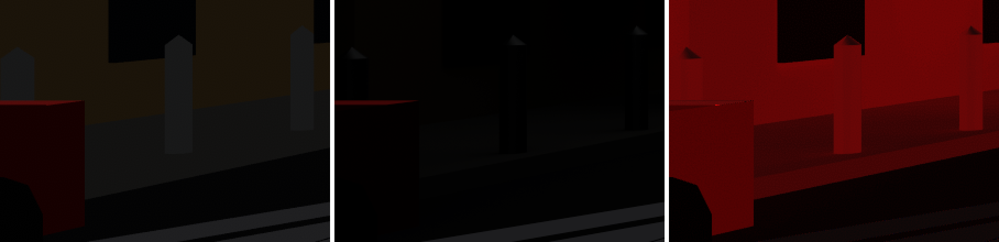
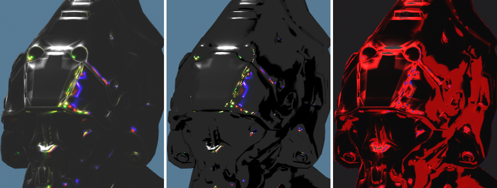
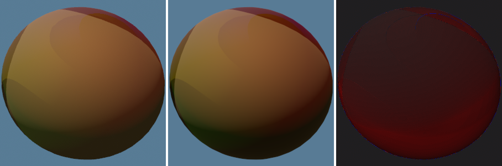
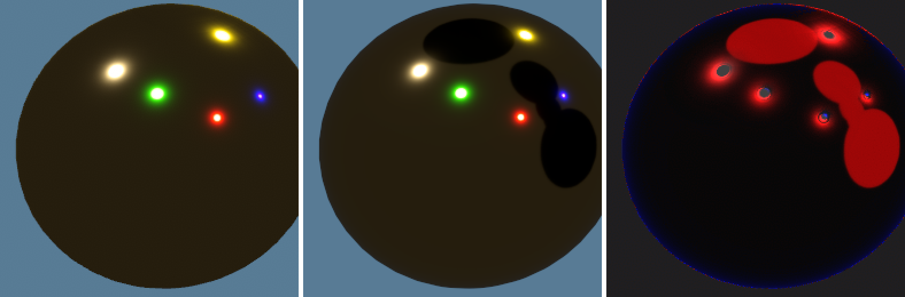
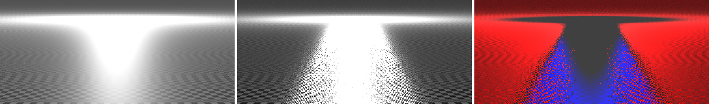
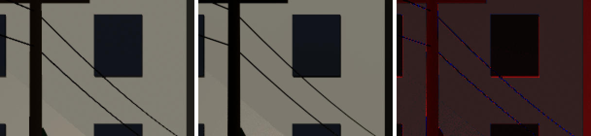
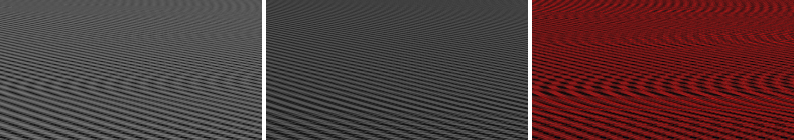

# Known differences from the Cycles reference

What praxis does not do yet, or does on purpose, and how each shows beside
its Cycles render, so that neither an audit nor a review reads it as a
defect. Anything else a Cycles difference image shows is a finding.

Each crop is praxis | Cycles | difference, from `scripts/gallery.sh` with
`PRAXIS_BLENDER` set, at 2x. The difference is praxis's capture dimmed to a
quarter, red where praxis is brighter and blue where Cycles is, at four
times the channel that differs most. A difference of an 8-bit step
or so everywhere is praxis's dither, which the Cycles image does not carry,
and fine speckle in Cycles' brightest highlights is its sampling noise.

The reference is direct light only, as praxis has no indirect light yet: a
reflection of another surface is black in Cycles.

## Ambient light without visibility

praxis's ambient, a stand-in for ADR 0020's irradiance probes, reaches every
surface at full strength, darkened only by a Material's occlusion texture.
Cycles' white world is blocked by whatever lies between a surface and the
sky. Shows wherever geometry hides the sky: a street's shaded walls and
pavement (`town`), and the reflections of metals, which in Cycles see the
object itself or its neighbours (`helmet`'s and `pbr-sweep`'s metals,
`normal-tangent`'s domes). Until the probes land.

## Ambient light as an ideal diffuse response

praxis's ambient reflects E/π times the base colour from every surface, an
ideal Lambertian surface's response, standing for the whole BRDF's. Cycles
integrates the BSDF itself over its white world, and single-scatter GGX
loses light to masking that grows with roughness and towards grazing, while
Fresnel moves light between the diffuse and specular lobes. Shows as praxis
a few 8-bit steps brighter wherever only the ambient lights a surface, most
on rough metals and towards rims (`pbr-sweep`, `orrery`, `shadows`).

## Highlights widened by specular antialiasing and Toksvig

praxis widens roughness for the shading normal's change across a pixel
(Tokuyoshi and Kaplanyan's specular antialiasing) and, in a normal
Texture's mips, for the normals each texel averages (Toksvig), so
highlights spread wider and dimmer than Cycles', which resolves them by
supersampling. Shows as a red ring around each highlight on smooth metals
(`pbr-sweep`, `helmet`, `normal-tangent`), and on `minification`'s bumpy
floor as a broad sheen where Cycles keeps a narrow streak: its whole floor
is brighter in praxis, more so with distance, the source of its large mean
difference.

## 4x MSAA against supersampling

praxis resolves edges from four samples per pixel; Cycles averages
hundreds. Shows as one-pixel lines along silhouettes, and along wires and
other geometry thinner than a pixel, whose coverage four samples quantise.

## BC compression and mips against source images

praxis samples BC-compressed Textures through mips filtered ahead of time;
Cycles samples the source images, before BC, mips or Toksvig, at each of its
samples. Shows where a Texture is minified, as differences in contrast and
in the moiré of fine patterns (`minification`, `texture-wall`, `uv-grid`).

